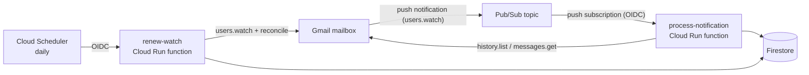

# card-expenses

A small serverless service that records my credit card purchases automatically.

My bank (BBVA Argentina) emails me every time I pay with a card. This service listens to that mailbox, extracts the date, merchant and amount from each notification and stores it in a database, so I can later see how much I have spent in the month and get alerts when I reach a threshold.

> Threshold alerts and expense categories are the next steps. This repository covers the ingestion pipeline, its infrastructure and a first read-only web app.

## How it works



1. A Gmail filter labels the bank's purchase emails. Gmail publishes a notification to Pub/Sub whenever a labelled message changes (`users.watch`).
2. Pub/Sub pushes the notification, authenticated with OIDC, to the `process-notification` function. The notification only carries a `historyId`, so the function asks the Gmail API for what changed, parses each email and saves it in Firestore.
3. The Gmail watch expires after 7 days, so a daily Cloud Scheduler job calls `renew-watch`, which renews it and **reconciles** the last 3 days of labelled emails. That way a lost notification never means a lost purchase.

## Web app

`web/` is a React app (Vite, TypeScript, Tailwind v4 and [shadcn/ui](https://ui.shadcn.com)) hosted on Firebase Hosting. After signing in with Google it has six tabs:

- **Inicio** (the first one): the **total to pay** of the current statement period and, while the last closed one has not fallen due yet, of that one too (it is hidden once the latest due date among the accounts has passed). Each period says which dates it covers, shows a progress bar against the monthly **spending cap**, "Más datos" (share of the spending per category, as bars and a pie) and the list of purchases. It also shows the alerts for data that is missing: purchases without a category (orange), fixed expenses or incomes of the month not loaded (red) and a new card without an account (yellow), each with a button to the right place.
- **Gastos**: the same card for the month you pick.
- **Tarjetas**: group cards into accounts, assign each card to a person and load each account's statement closing and due dates.
- **Categorías**: the purchases that still need a category, the categories themselves (name and colour) and the merchant → category dictionary.
- **Presupuesto**: the fixed monthly expenses (their kinds and what was paid each month, with a 1-2-3 counter for the rent, which is updated every three months), the incomes and the savings (amount, currency, date), and the monthly spending cap.
- **Balance**: the balance of a month (income − fixed expenses − the card statements that fall due in it) and, below, a collapsible history with one row per month.

Debit cards and cards without an account are left out of the totals; rejected purchases are listed but never counted.

The names of the people whose incomes are tracked are configuration, not code: set `VITE_OWNERS` (comma separated) in `web/.env`, next to the Firebase values (see `web/.env.example`).

Security does not rely on the UI: Firestore security rules (`firestore.rules`) only allow reading `expenses` to accounts with a verified email and a custom claim, `household`, that the owner assigns to each authorized person with `scripts/grant-access.js`. `state/sync` cannot be touched from a browser, and the ingestion functions write `expenses` with the Admin SDK, which bypasses the rules; from a browser an expense can only get or lose its `categoryId`. The browser can write the collections of the sections above (`accounts`, `cards`, `cycles`, `categories`, `merchantCategories`, `incomes`, `savings`, `fixedTypes`, `fixedExpenses`, `exchangeRates` and `spendingCaps`) with strict rules: same `household` condition, exact fields and types, and IDs that match their fields. After changing `firestore.rules`, redeploy them with `npm run web:deploy -- --project <project-id>` (see [RUNBOOK.md](RUNBOOK.md)).

## Design decisions

- **Idempotent writes.** Each expense is stored with the Gmail message ID as its document ID and created with `create()`, so retries and reprocessing never duplicate a purchase.
- **Errors are classified.** An email that cannot be parsed is logged with `ERROR` severity (which triggers an alert) and skipped, and the function answers `2xx` so Pub/Sub does not retry forever. Transient failures (Gmail, Firestore) answer `5xx` so Pub/Sub retries. The history pointer only advances after a whole batch succeeds.
- **The parser does not depend on icons or CSS.** The bank has several templates (credit, debit, additional card, rejected purchase). The parser relies on the order and shape of the texts instead of on file names, and it is covered by tests with real-world samples with every personal detail replaced.
- **Rejected purchases are kept** with `status: "rejected"` and excluded from sums; card type (`credit` / `debit`) and holder are stored too.
- **Private functions.** Both functions only accept calls authenticated as a dedicated service account (Pub/Sub push and Scheduler use OIDC). There are no public endpoints.
- **No credentials in code, Git or Terraform state.** Terraform creates only the Secret Manager container; `scripts/authorize.js` runs the OAuth flow locally and stores the credentials straight into it.
- **Free tier by design.** The functions scale to zero and have low instance caps, there is a monthly budget alert, and the database is Firestore.

## Data model

Collection `expenses`, one document per purchase (document ID = Gmail message ID):

| Field | Type | Notes |
|---|---|---|
| `purchaseDate` | Timestamp | date in the email, interpreted in Buenos Aires time |
| `receivedAt` | Timestamp | when the email was received |
| `merchant` | string | |
| `amount`, `currency` | number, string | e.g. `12500`, `ARS` |
| `cardLast4` | string | |
| `cardType` | `credit` \| `debit` | |
| `cardHolder` | string | first name only; for additional cards, the name after "a nombre de" |
| `status` | `approved` \| `rejected` | |
| `categoryId` | string | optional; the ID of a document of `categories`. The ingestion service sets it when the merchant is already in the dictionary (`merchantCategories`) |

Collections written from the web app (calendar dates are stored as `YYYY-MM-DD` strings):

| Collection | Document ID | Fields |
|---|---|---|
| `accounts` | generated | `name`, `owner` |
| `cards` | `{last4}_{type}` | `last4`, `type` (`credit` \| `debit`), `holder`, `accountId` |
| `cycles` | `{accountId}_{closingDate}` | `accountId`, `closingDate`, `dueDate` (or `null`) |
| `categories` | generated | `name`, `color` (`#rrggbb`) |
| `merchantCategories` | merchant key | `merchant`, `categoryId`. The key is the merchant name in lower case, without accents and without the words that contain digits, joined by `-` (see `src/merchant.js`) |
| `incomes` | generated | `amount`, `currency` (`ARS` \| `USD`), `date`, `owner` |
| `savings` | generated | `amount`, `currency`, `date` |
| `fixedTypes` | generated | `name`, `disabled` (a type is never deleted, only disabled) |
| `fixedExpenses` | `{typeId}_{YYYY-MM}` | `typeId`, `month`, `amount` (one per type and month) |
| `exchangeRates` | `YYYY-MM` | `rate` (pesos per dollar, to turn the dollar incomes into pesos) |
| `spendingCaps` | `YYYY-MM` | `amount` (a month without a cap uses the latest one defined before it) |

## Tech stack

Node.js (ESM) · Gmail API · Cloud Pub/Sub · Cloud Run functions · Cloud Scheduler · Firestore · Secret Manager · Cloud Monitoring · Terraform · Vitest · cheerio

## Repository layout

```
src/            parser, Gmail message decoding, sync logic, Firestore store, Gmail client, function entry points
test/           unit tests and anonymized email fixtures
scripts/        authorize.js (OAuth), get-label-id.js, reprocess.js (backfill), grant-access.js (web app access)
terraform/      the infrastructure of the ingestion service
web/            the React app: purchases and the Cards section (see its own tests and build)
firestore.rules security rules used by the web app
firebase.json   Firebase Hosting, rules and emulator configuration
design/         design documents and implementation plans (ingestion service and web app)
docs/           GitHub Pages site (home page and privacy policy used by the Google OAuth consent screen)
RUNBOOK.md      step-by-step deployment guide
```

## Running the tests

```
npm install
npm test               # parser, decoding, sync logic and handlers
npm run test:store     # data layer against the Firestore emulator (needs Java)
npm run test:rules     # Firestore security rules against the emulator (needs Java)
npm --prefix web install && npm --prefix web test   # web app tests
```

## Deploying

The infrastructure is defined with Terraform; a few one-time steps (billing account, OAuth consent screen, Gmail filter and label) are manual. Everything is documented in [RUNBOOK.md](RUNBOOK.md), and the reasoning behind the design is in [design/spec.md](design/spec.md).

## Privacy

The web app signs people in with Google (Firebase Authentication) and only authorized accounts can read the data. The service has read-only access (`gmail.readonly`) to the owner's mailbox and only queries emails carrying a specific label. Only the purchase date, merchant, amount, currency, card digits, card type and holder first name are stored, plus what the authorized people enter in the Cards section (account names, the assignment of cards to people and statement closing/due dates). See the [privacy policy](docs/privacy.html).
