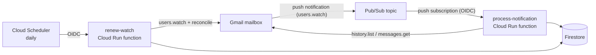

# card-expenses

A small serverless service that records my credit card purchases automatically.

My bank (BBVA Argentina) emails me every time I pay with a card. This service listens to that mailbox, extracts the date, merchant and amount from each notification and stores it in a database, so I can later see how much I have spent in the month and get alerts when I reach a threshold.

> The visualization app and the threshold alerts are the next steps and are not part of this repository yet. This repository covers the ingestion pipeline and its infrastructure.

## How it works



1. A Gmail filter labels the bank's purchase emails. Gmail publishes a notification to Pub/Sub whenever a labelled message changes (`users.watch`).
2. Pub/Sub pushes the notification, authenticated with OIDC, to the `process-notification` function. The notification only carries a `historyId`, so the function asks the Gmail API for what changed, parses each email and saves it in Firestore.
3. The Gmail watch expires after 7 days, so a daily Cloud Scheduler job calls `renew-watch`, which renews it and **reconciles** the last 3 days of labelled emails. That way a lost notification never means a lost purchase.

## Design decisions

- **Idempotent writes.** Each expense is stored with the Gmail message ID as its document ID and created with `create()`, so retries and reprocessing never duplicate a purchase.
- **Errors are classified.** An email that cannot be parsed is logged with `ERROR` severity (which triggers an alert) and skipped, and the function answers `2xx` so Pub/Sub does not retry forever. Transient failures (Gmail, Firestore) answer `5xx` so Pub/Sub retries. The history pointer only advances after a whole batch succeeds.
- **The parser does not depend on icons or CSS.** The bank has several templates (credit, debit, additional card, rejected purchase). The parser relies on the order and shape of the texts instead of on file names, and it is covered by tests with real-world samples with every personal detail replaced.
- **Rejected purchases are kept** with `status: "rejected"` and excluded from sums; card type (`credit` / `debit`) and holder are stored too.
- **Private functions.** Both functions only accept calls authenticated as a dedicated service account (Pub/Sub push and Scheduler use OIDC). There are no public endpoints.
- **No credentials in code, Git or Terraform state.** Terraform creates only the Secret Manager container; `scripts/authorize.js` runs the OAuth flow locally and stores the credentials straight into it.
- **Free tier by design.** The functions scale to zero and have low instance caps, there is a monthly budget alert, and the database is Firestore.

## Data model

Collection `expenses`, one document per purchase (document ID = Gmail message ID):

| Field | Type | Notes |
|---|---|---|
| `purchaseDate` | Timestamp | date in the email, interpreted in Buenos Aires time |
| `receivedAt` | Timestamp | when the email was received |
| `merchant` | string | |
| `amount`, `currency` | number, string | e.g. `12500`, `ARS` |
| `cardLast4` | string | |
| `cardType` | `credit` \| `debit` | |
| `cardHolder` | string | first name only; for additional cards, the name after "a nombre de" |
| `status` | `approved` \| `rejected` | |

## Tech stack

Node.js (ESM) · Gmail API · Cloud Pub/Sub · Cloud Run functions · Cloud Scheduler · Firestore · Secret Manager · Cloud Monitoring · Terraform · Vitest · cheerio

## Repository layout

```
src/            parser, Gmail message decoding, sync logic, Firestore store, Gmail client, function entry points
test/           unit tests and anonymized email fixtures
scripts/        authorize.js (OAuth), get-label-id.js, reprocess.js (backfill)
terraform/      all the infrastructure
design/         design document and implementation plan
docs/           GitHub Pages site (home page and privacy policy used by the Google OAuth consent screen)
RUNBOOK.md      step-by-step deployment guide
```

## Running the tests

```
npm install
npm test               # parser, decoding, sync logic and handlers
npm run test:store     # data layer against the Firestore emulator (needs Java)
```

## Deploying

The infrastructure is defined with Terraform; a few one-time steps (billing account, OAuth consent screen, Gmail filter and label) are manual. Everything is documented in [RUNBOOK.md](RUNBOOK.md), and the reasoning behind the design is in [design/spec.md](design/spec.md).

## Privacy

The service has read-only access (`gmail.readonly`) to the owner's mailbox and only queries emails carrying a specific label. Only the purchase date, merchant, amount, currency, card digits, card type and holder first name are stored. See the [privacy policy](docs/privacy.html).
